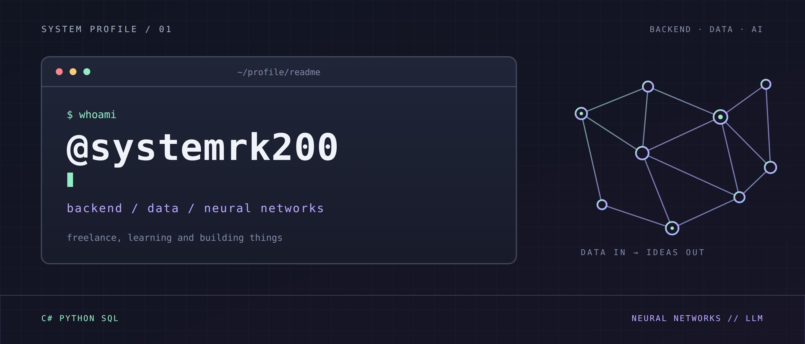

  

<h1 align="center">Привет, я Ксения</h1>

<strong>Backend-разработчик · Инженер данных · Разработка нейросетей</strong>

  <a href="mailto:kseniakk890@gmail.com">Email</a> &nbsp;·&nbsp;
  <a href="https://t.me/systemrk200">Telegram</a> &nbsp;·&nbsp;
  <a href="https://github.com/systemrk200">GitHub</a>

Я backend-разработчик и инженер данных. Есть опыт разработки нейросетей с нуля и интеграции AI в приложения. В проектной работе решаю задачи для заказчиков, а в свободное время делаю собственные проекты.

## Направления и инструменты

**Backend-разработка**  
`C#` · `.NET / ASP.NET Core` · `Entity Framework Core` · `ADO.NET` · `FastAPI` · `REST API` · `WebSocket` · `Kafka` · `Docker`

**Инженерия данных и аналитика**  
`Python` · `SQL` · `PostgreSQL` · `SQL Server` · `ClickHouse` · `ETL / ELT` · `Airflow` · `Apache Spark` · `pandas / NumPy` · `Power BI`

**Нейросети и AI**  
`LLM API` · `RAG` · `MCP` · `Gemini` · `нейросетевые модели с нуля`

Разработала перцептрон и сеть Хопфилда с нуля, без готовых библиотек. Сейчас занимаюсь RAG-поиском по юридическим текстам и приложением с AI-помощником.

**Ещё использую в проектах**  
`JavaScript / TypeScript` · `PHP / Laravel` · `Node.js` · `React` · `Avalonia / XAML / MVVM` · `Git / Linux`

## Фриланс и pet-проекты

- Разрабатывала приложения на **.NET / Avalonia** для обработки и анализа текста.
- Создала приложение для совместного разбора инцидентов: рабочие пространства, файлы, общение в реальном времени и AI-помощник.
- Прорабатываю инкрементальную загрузку обновлений заказов с обработкой повторов и поздних изменений.
- В свободное время делаю небольшие приложения и эксперименты с нейросетями.

<a href="mailto:kseniakk890@gmail.com">kseniakk890@gmail.com</a> · <a href="https://t.me/systemrk200">@systemrk200</a>

